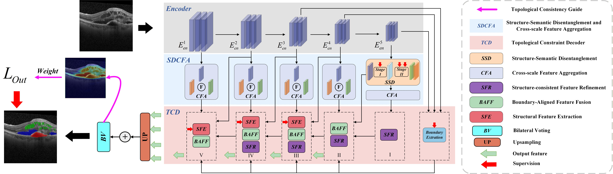
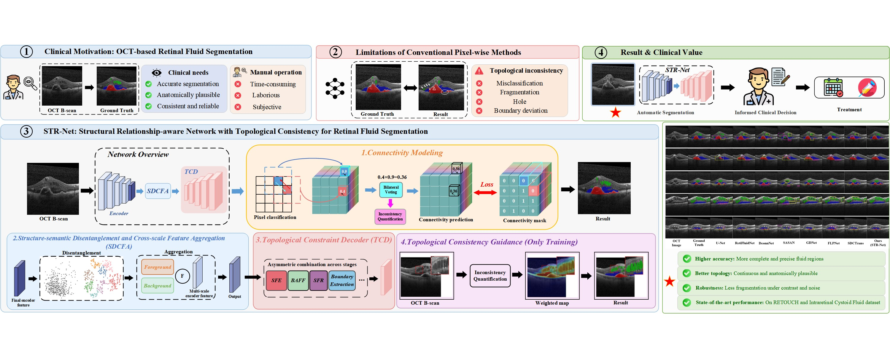
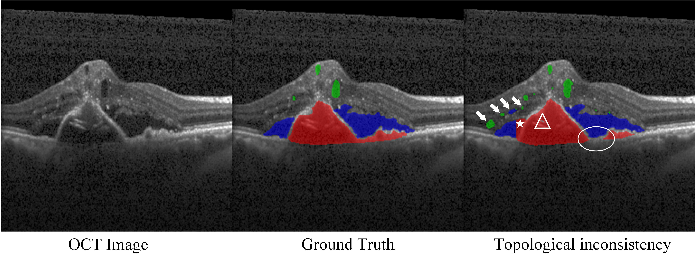
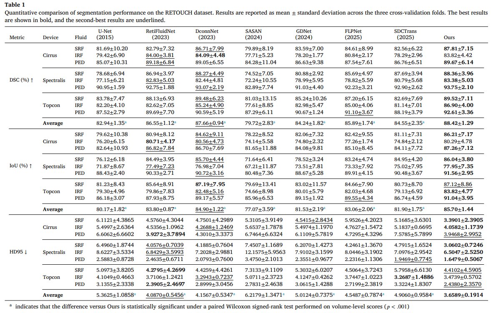
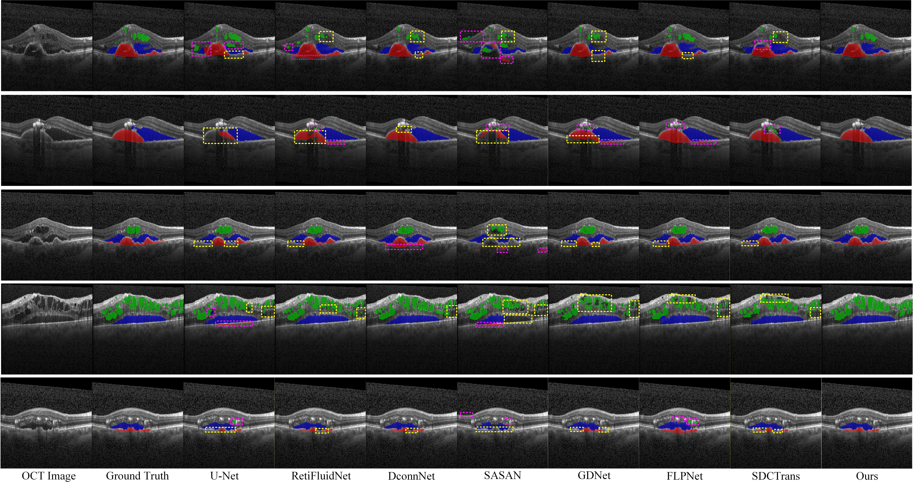
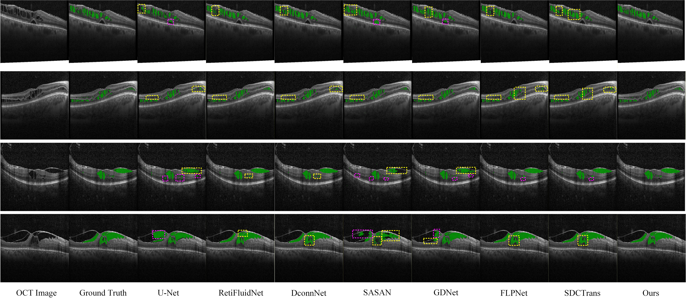

<div align="center">
    <h1 align="center">[ESWA 2026] STR-Net: Structural Relationship-aware Network with Topological Consistency for Retinal Fluid Segmentation
    </h1>
</div>

<p align="center">
  <!-- Fig. 2 of the paper: Framework5.0.jpg → assets/framework.jpg -->
  
</p>

- **Authors**: Haiying Xia, Jiabin Xu, Lingyu Wu, [Shuxiang Song](mailto:ssx_9@mailbox.gxnu.edu.cn)📧
- **Institutes**: Guangxi Normal University; Guangxi Academy of Artificial Intelligence
- **Resources**: [📖[Paper](https://doi.org/10.1016/j.eswa.2026.135036)]

## 🖼️ Graphical Abstract

<p align="center">
  
</p>

STR-Net turns OCT fluid segmentation into pixel-connectivity prediction. SDCFA, TCD, and topological consistency guidance keep the masks anatomically consistent.

## 📖 Introduction

**STR-Net** is a structural relationship-aware network for retinal fluid segmentation on optical coherence tomography (OCT). It is designed for the topological failures that show up when diabetic macular edema biomarkers are segmented one pixel at a time. Unlike previous approaches that assign an independent class label to every location, STR-Net reformulates segmentation as **pixel-connectivity prediction**.

For each pixel, the network predicts whether it is connected to its eight neighbors. When the two directions of a pair disagree, a topological consistency guidance strategy turns that discrepancy into a spatially adaptive loss weight, so training spends more effort on structurally unreliable regions. A structure-semantic disentanglement and cross-scale feature aggregation (SDCFA) module separates structural cues from semantic representations, and a topological constraint decoder (TCD) injects structural priors and boundary information while resolution is restored. Bilateral voting then symmetrizes the connectivity maps, and the fluid mask is read out from those agreements. On the RETOUCH and Intraretinal Cystoid Fluid datasets, this produces segmentations of intraretinal fluid (IRF), subretinal fluid (SRF), and pigment epithelial detachment (PED) that stay both accurate and topologically consistent.

<p align="center">
  <!-- Fig. 1 of the paper: Topological inconsistencies.jpg → assets/introduction.jpg -->
  
</p>

## 💡 Highlights

- 🔥 **Pixel Connectivity Modeling.** Retinal fluid segmentation is modeled through neighborhood connectivity. The mask comes from relations between adjacent pixels, rather than from isolated class labels.
- 🔥 **Topological Consistency Guidance.** Bidirectional connectivity discrepancies become adaptive supervision. Larger disagreements mark structurally unstable regions and receive higher loss weights.
- 🔥 **Structure-Semantic Disentanglement.** The SDCFA module disentangles structural features from semantic representations and aggregates them across scales.
- 🔥 **Topological Constraint Decoding.** The TCD module injects structural priors and boundary information during decoding, so the restored mask stays anatomically consistent.
- 🔥 **Strong Benchmark Results.** STR-Net reaches the best or second-best scores on most metrics of RETOUCH and the Intraretinal Cystoid Fluid dataset, with clearer gains on overlap, boundary distance, and connected-component consistency.

<!-- Table 1 of the paper, cropped from the proof PDF → assets/table.jpg -->


## Qualitative Results

Qualitative comparison follows Section 4.4.3 of the paper. Yellow boxes mark under-segmentation, and pink boxes mark over-segmentation.

### RETOUCH

On RETOUCH, green, blue, and red denote IRF, SRF, and PED. The paper groups the failure patterns of existing methods into three types: confusion between adjacent fluid categories, fragmented or discontinuous boundaries in ambiguous regions, and incorrect merging of structurally disconnected lesions. Pixel-wise methods lack an explicit model of inter-pixel structural relationships, so their topology breaks up and the anatomy becomes inconsistent. Existing connectivity-based methods still miss the regions where topological errors arise, and they do not keep structural consistency across scales, especially along ambiguous boundaries and in lesions with complex morphology.

Across these cases, STR-Net produces more anatomically consistent masks. In the first and third rows, where several fluid types coexist, it separates adjacent lesion categories and keeps clearer structural boundaries. U-Net, SASAN, and SDCTrans tend to confuse categories around overlapping or ambiguous regions. In the low-contrast and noisy cases of the second and fifth rows, competing methods often fragment the boundary or label retinal tissue as fluid. STR-Net keeps boundary continuity and structural coherence by modeling structural priors and connectivity consistency. In the fourth row, sac-like IRF varies strongly in shape. Other methods often leave the prediction discontinuous or structurally incomplete, while STR-Net keeps a more complete lesion topology and finer structural detail.

<!-- Fig. 6: Visualize-RETOUCH.jpg → assets/qualitative_retouch.jpg -->
<p align="center">
  
</p>

### Intraretinal Cystoid Fluid

On the Intraretinal Cystoid Fluid dataset, STR-Net delineates narrow, strip-like fluid that looks similar to the neighboring retinal tissue and is difficult for the competing methods to segment. It also avoids merging fluid regions that lie next to each other but are not connected. The last column shows a more accurate outline of fine fluid detail. The paper attributes this to modeling the difference between the two directions of a connectivity prediction and to the structural constraints used during segmentation, which reduces cases where retinal tissue is labeled as fluid.

<!-- Fig. 7: Visualize-ICF.jpg → assets/qualitative_icf.jpg -->
<p align="center">
  
</p>

## Code Release

Training code, inference scripts, and pretrained weights are in preparation and will be released in this repository.

## 📜 News

- **[2026/11/12]** 🚀 Code and model release preparation.
- **[2026/11/05]** 🎉 **STR-Net** is accepted by **Expert Systems with Applications** (Elsevier, article **135036**). The paper is in press. [DOI](https://doi.org/10.1016/j.eswa.2026.135036)

## 👨‍💻 Todo

- [x] Paper accepted by Expert Systems with Applications
- [ ] Release training code
- [ ] Release inference code
- [ ] Release pretrained weights

## ✒️ Citation

If you find our work helpful for your research, please consider giving one star ⭐️ and citing:

```bibtex
@article{XIA2026135036,
  title   = {STR-Net: Structural Relationship-aware Network with Topological Consistency for Retinal Fluid Segmentation},
  journal = {Expert Systems with Applications},
  pages   = {135036},
  year    = {2026},
  issn    = {0957-4174},
  doi     = {10.1016/j.eswa.2026.135036},
  url     = {https://www.sciencedirect.com/science/article/pii/S0957417426039382},
  author  = {Haiying Xia and Jiabin Xu and Lingyu Wu and Shuxiang Song}
}
```

## ❤️ Acknowledgments

- [RETOUCH](https://retouch.grand-challenge.org/) (Bogunović et al., 2019): the retinal OCT fluid detection and segmentation benchmark used in our experiments.
- Intraretinal Cystoid Fluid dataset (Ahmed et al., 2022): the cystoid macular edema benchmark used in our experiments.
- BiconNet (Yang et al., 2022): the bilateral voting mechanism used to symmetrize connectivity predictions.
- [DconnNet](https://github.com/Zyun-Y/DconnNet) (Yang and Farsiu, 2023)
